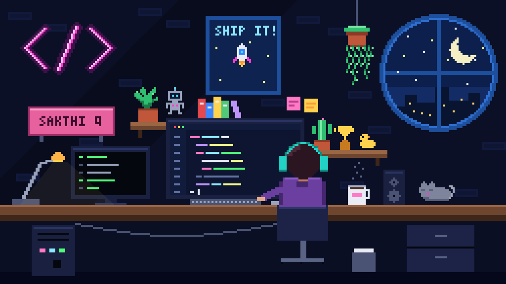

<div align="center">



# 👋 Hey, I'm Sakthi Q

**Computer Science & Engineering Undergraduate · Aspiring AI Engineer · Generative AI & Backend Developer**

<p>
  <a href="https://github.com/SakthiQ"></a>
  <a href="https://www.linkedin.com/in/sakthinarayan-v"></a>
  <a href="https://www.instagram.com/sakuthi.v/"></a>
</p>


</div>

---

## 🧠 About Me

Computer Science & Engineering undergraduate focused on building intelligent systems that connect AI with enterprise applications.

My current engineering focus is on **RAG pipelines, AI agents, context engineering, LLM applications, and scalable backend systems**. I also have exposure to enterprise platforms through work with **Oracle Fusion Cloud AI Agent Studio** and ERP workflows.

```text
Generative AI & RAG   ███████████████████░
Backend Engineering   █████████████████░░░
ML & NLP              ████████████████░░░░
Frontend (React · TS) ███████████████░░░░░
DSA                   ███████████████░░░░░
System Design         ██████████████░░░░░░
DevOps & Cloud        ████████████░░░░░░░░
```

## ⚙️ What I'm Working On

- 🤖 Production RAG systems, retrieval pipelines and grounded generation
- 🧩 Agentic AI, tool use and context engineering
- ☕ Java, Spring Boot, REST APIs, microservices and backend architecture
- 🏢 Enterprise AI applications around Oracle Fusion Cloud and ERP workflows
- 🧠 LLMs, embeddings, vector databases and domain-specific NLP

## 💻 Tech Stack

### Languages

<p></p>

### Backend & Frontend

<p></p>

### AI / ML / RAG

<p></p>

<p>
  
  
  
  
  
  
  
  
</p>

### Databases / DevOps / Web3

<p></p>

<p>
  
  
  
</p>

### Enterprise

<p>
  
  
</p>

## 🚀 Featured Projects

### 🏥 [Healthcare Appointment & Follow-up Manager](https://github.com/SakthiQ/Healthcare-Appointment-Follow-up-Manager)

**Open-source hospital management platform with AI built in**

Separate portals for patients, doctors and admins. AI turns patient symptoms into a pre-visit summary for the doctor, and doctor notes into a plain-language summary and medication schedule for the patient. Email reminders and Google Calendar sync run in the background, and a booking never fails because an outside service is down.

**Stack:** Python · FastAPI · PostgreSQL · SQLAlchemy · React · TypeScript · Vite · LLMs

`Role-based Portals` `AI Summaries` `Reminders` `Calendar Sync` `CI-tested`

### 🛡️ [ATTS-RAG](https://github.com/SakthiQ/ATTS-RAG)

**Adaptive Threat-Intelligence Trusted & Secure RAG**

Fully local document Q&A where every sentence of an answer is checked against the source documents and cited. Three security layers screen questions for prompt injection, filter evidence by tenant and clearance, and drop any claim the evidence doesn't support.

**Stack:** Python · FastAPI · LangChain · Ollama · Sentence Transformers · Streamlit

`Hybrid Search` `BM25` `Reranking` `Prompt-Injection Defense` `Verified Citations`

### 🩺 [Medical Miscommunication Detector](https://github.com/SakthiQ/nlp-medical-miscommunication-detector)

**Clinical NLP pipeline for patient-friendly medical explanations**

Turns hard-to-read medical reports into plain-language explanations grounded in a curated, cited knowledge base, without ever diagnosing or prescribing. Output is safety-validated, then translated and spoken in Hindi, Tamil, Telugu and Malayalam.

**Stack:** Python · FastAPI · HuggingFace Transformers · negspacy · FAISS · LLMs · NLLB · gTTS

`Medical NER` `Negation Detection` `Grounded Generation` `Safety Validation` `Translation` `TTS`

### ⚡ [HotReload](https://github.com/SakthiQ/Hotreload)

**Zero-ceremony hot reload CLI for Go**

Watches your project, rebuilds it and restarts the running server on save. About 700 lines of Go with a single dependency, with crash-loop backoff and first-class Windows, macOS and Linux support.

**Stack:** Go · fsnotify · slog · Make · GitHub Actions

`File Watcher` `Auto Rebuild` `Process Restart` `Crash-loop Backoff` `Cross-platform`

## 🏢 Experience

### Hexaware Technologies — R&D Intern

Worked with **Oracle Fusion Cloud AI Agent Studio**, focusing on enterprise AI use cases across Inventory Management and Procurement.

`Enterprise AI` `Oracle Fusion Cloud` `AI Agents` `ERP`

## 🏆 Highlights

- 🎯 Generative AI & RAG systems
- 🏢 Oracle Fusion Cloud AI Agent Studio
- 🧠 Agentic AI & Context Engineering
- 🔬 Clinical NLP & evidence-grounded generation
- ⚙️ Backend systems & developer tooling
- 🏅 Hackathon / project-based engineering experience

## 📊 GitHub Stats

<div align="center">


<br/>


<br/><br/>

<picture>
  <source media="(prefers-color-scheme: dark)" srcset="https://raw.githubusercontent.com/SakthiQ/SakthiQ/output/github-snake-dark.svg"/>
  <source media="(prefers-color-scheme: light)" srcset="https://raw.githubusercontent.com/SakthiQ/SakthiQ/output/github-snake.svg"/>
  
</picture>

</div>

## 🧩 Core Competencies

| Generative AI | Backend | Frontend | ML & NLP | Data & DevOps |
|---|---|---|---|---|
| RAG Pipelines | FastAPI | React | Medical NER | PostgreSQL · MySQL |
| Hybrid Search & Reranking | Spring Boot | TypeScript | Embeddings & Semantic Search | MongoDB · Redis |
| AI Agents & Context Engineering | Node.js · Express | Next.js · Vite | Classification (scikit-learn, XGBoost) | Vector DBs (FAISS, ChromaDB) |
| LLM Guardrails & Answer Verification | REST APIs · JWT Auth · RBAC | Tailwind CSS | Computer Vision (OpenCV) | Docker · GitHub Actions |
| Prompt Engineering | Background Workers | Streamlit | RAG Evaluation (RAGAS) | AWS |

## 📚 Currently Learning

Advanced System Design · Distributed Systems · Agentic AI · Multi-Agent Orchestration · Cloud-Native Architecture · DSA

## 🤝 Let's Connect

<div align="center">

*Building AI systems. Learning backend engineering. Shipping real projects.*

<a href="https://www.linkedin.com/in/sakthinarayan-v"></a>
<a href="https://github.com/SakthiQ"></a>
<a href="https://www.instagram.com/sakuthi.v/"></a>

<br/><br/>


**Open to AI Engineering · Backend Engineering · ML Engineering opportunities**

</div>
